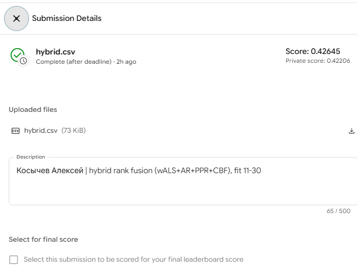
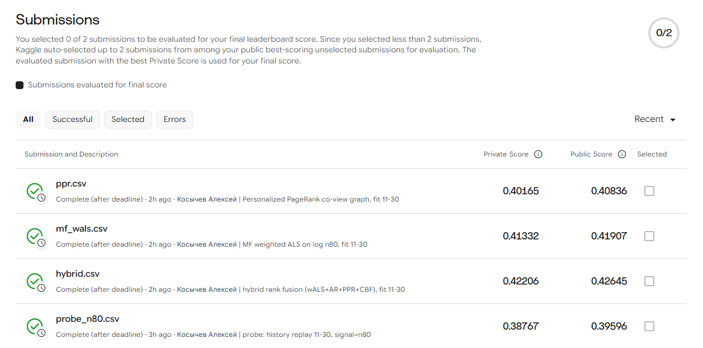
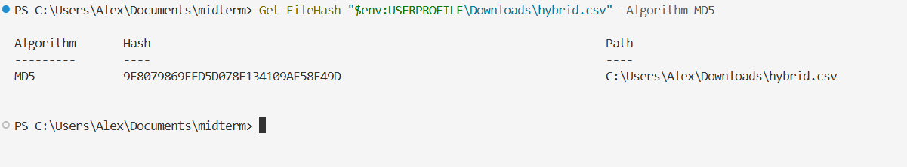
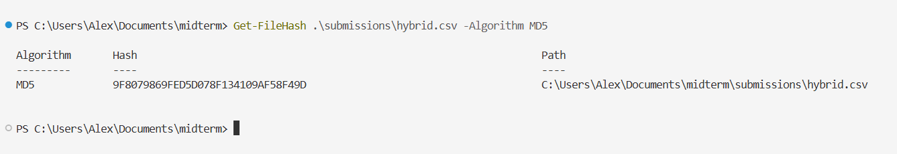
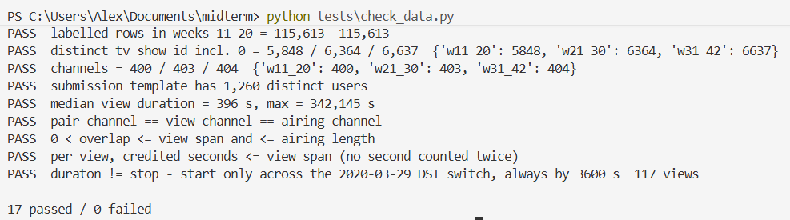
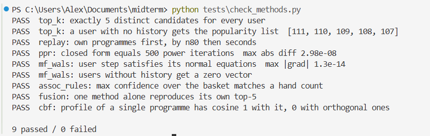

# Familiar Programmes, Counted: Weighted ALS and Rank Fusion for sweet.tv TV Recommendation

Student: Aleksei Kosychev &nbsp;&nbsp; Team: Individual &nbsp;&nbsp; Email: amkosychev@edu.hse.ru &nbsp;&nbsp; Date: 2026-10-23 
Midterm quiz (GSB): TV programme recommendation on sweet.tv, Kaggle MAP@5 &nbsp;&nbsp;
Code and submission files: <a href="https://github.com/ak1232320/rec-sys-midterm">github.com/ak1232320/rec-sys-midterm</a>

## Abstract

I join 5.8 M views to the broadcast schedule and predict each of 1,260 users' five most-preferred
programmes for weeks 31-42. Two submissions that differ only in the ranking signal show that the target
behaves like *the number of airings a user watched ≥ 80% of in one view* (n80). I use that definition for
validation: fit on weeks 11-20, score on 21-30.

On that split, a weighted ALS that regresses log n80 is the best single method, at MAP@5 0.324. It is
followed by Personalized PageRank (0.319), implicit ALS (0.314), history replay (0.308), association rules
(0.277), popularity (0.223) and CBF (0.185). A rank fusion of four methods adds +0.003 on held-out users
(95% CI [0.001, 0.005]) and is best in every activity quartile.

The order carries over to the test window. Kaggle public scores are 0.4265 for the hybrid, 0.4191 for
weighted ALS, 0.4084 for PageRank and 0.3960 for replay. About 95% of what every history-based method
recommends is already familiar to the user: this platform's preferences are mostly habits.

## 1. Data and interactions

**The data.** The competition data [7]: the view log has 5,821,987 views by 4,914 users on 202 channels in ISO weeks 11-30 of 2020.
All 1,260 test users appear in it. Only **10.8% of schedule rows (16-17% of airtime) carry a programme
id**. Labels follow the category: entertainment, films, series and children's shows are 44-86% labelled,
sport and music almost never. Yet **56% of viewing seconds land on labelled airings**.

**The join.** A view matches an airing when they are on the same channel and their intervals overlap.
Both sources use local wall-clock time. The 117 views whose `duraton` differs from `stop − start` differ
by exactly 3,600 s, and they are exactly the views spanning the 2020-03-29 switch to summer time. View
stops cluster at programme boundaries only when no shift is applied.

Three adjustments follow:

* five airings that overrun the next one are cut at its start;
* 12% of views overlap another view of the same account, so a user's time on an airing is the **union**
  of their intervals, not the sum;
* `tv_show_id = 0` is unlabelled airtime and never an item.

**What counts as watched.** No view in the log is shorter than 61 s, so zapping has already been
removed. Overlaps under 60 s are only the edges of views that straddle a boundary (2.5% of user × airing
pairs, 0.05% of seconds), so 60 s is the floor for any interaction. The share of an airing that a user
covers is U-shaped: 27% of pairs cover under 5% and 16% cover at least 95%. A search-engine summary of the
2nd-place write-up [1] quotes the organisers' rule as "over 80% of the programme without changing the
channel". That rule defines **n80**, the number of a user's airings of a programme that one view covered
by ≥ 80% of the airing's scheduled duration. So I use both kinds of cut: a fraction-of-duration cut (80%)
defines the preference signal, and an absolute floor (60 s) defines any interaction.

**Which target.** Ranking by seconds, by airings ≥ 60 s or by n80 gives different top-5 lists: an oracle
of one definition scores only 0.46-0.57 MAP@5 against another. I submitted history replay twice, ranked
once by seconds and once by n80:

| ranked by | public | private | proxy prediction of secs − n80, if the truth is: |
|---|---|---|---|
| seconds | 0.2794 | 0.2494 | secs: +0.064 &nbsp; n60: −0.022 &nbsp; n80: −0.095 |
| n80 | 0.3960 | 0.3877 | observed: **−0.117** |

Only the n80 hypothesis fits, so **truth = a user's top-5 by n80**.

**Two log defects.** From 17 Jun to 2 Jul the number of users per day halves, and 3 Jul is missing.
Sessions longer than 4 h make up 1.4-3.3% of views in weeks 19-24 and 27-30, but at most 0.04% in weeks
11-18. n80 counts airings rather than seconds, which makes it less exposed to both.

## 2. Methods

**Shared protocol.**

* Every method sees only the history weeks.
* The candidate pool is the labelled programmes in the target window's schedule (6,363 for 21-30, 6,636
  for 31-42). The test schedule is used only to know what airs.
* **Repeats are allowed**, because 67% of next-window top-5 items were already in the user's history.
* One shared function turns any score matrix into exactly five distinct ids, breaking ties by popularity.
  A user without usable history gets an all-zero row, and therefore **the popularity list from every
  method**. This applies to two test users.

**Methods.**

* **Popularity** (required baseline): programmes ordered by the number of users with an n80 interaction.
* **History replay** (reference only): the user's programmes by n80, then by seconds.
* **MF (a): implicit ALS** [2] on n80, confidence 1 + α·n80, using `implicit` 0.7.3.
* **MF (b): weighted ALS on graded counts**, my own implementation. It minimises Σ c(r − x_u·y_i)² + λ‖·‖²
  with r = log(1 + n80) and c = 1 + α·r, with target 0 and weight 1 on unobserved cells. Variant (a)
  learns *whether* a user watches; this one keeps *how often*.
* **Personalized PageRank** [3] on the programme co-view graph:
    * edge weight = users with n80 on both programmes, no self-loops;
    * restart probability β at the user's n80 vector r_u;
    * π_u = β r_u (I − (1−β)P)^{-1}, solved exactly. One inverse, at most 7.9k × 7.9k, serves all users
      in a few seconds.
* **Association rules across time** [4]. x → y counts users with x in the first half of the history and
  y in the second, and x → x measures how often a programme's audience returns. The score is the highest
  confidence among rules whose antecedent is in the user's recent half.
* **CBF** [5]: TF-IDF over category, genres, decade, directors and actors (names shared by ≥ 2
  programmes), with field weights. The profile is the n80-weighted sum and the score is the cosine.
  Attributes are read from all three schedule files, including 31-42, so that new programmes have a
  vector. They describe programmes; no viewing enters them.
* **Hybrid: rank fusion** [6]. Score = Σ_m w_m / (c + rank_m) over each method's top 100. Ranks are used
  because the scores share no scale.

**Validation.** Methods are fit on weeks 11-20 and scored on each user's n80 top-5 in weeks 21-30,
against the 21-30 candidates. This keeps time order and is the closest available copy of the real task,
history followed by the next window, and it splits the 20 training weeks into equal halves. The metric is MAP@5 over the 4,623 users with a non-empty truth, of whom
1,236 are test users. Hyperparameters are chosen on all users (grids in `validation.json`). The hybrid's
weights and c are chosen by coordinate ascent on one half of the users and scored on the other (2-fold,
seed 42).

For the submissions, everything is refit on weeks 11-20 + 21-30. Longer history helps: PageRank on 5, 8
and 10 weeks scores 0.303, 0.314 and 0.319. Environment: Windows 11, Intel i5-13420H, 16 GB RAM, Python
3.12.10, numpy 2.3.5, scipy 1.17.0, pandas 2.3.3, implicit 0.7.3. Seed 42 is used for ALS initialisation
and the cross-validation split, and no other step is random. Per-method runtimes are in the results table.

## 3. Results

| method | selected hyperparameters | MAP@5 all | test users | Kaggle public / private | fit, 11-30 |
|---|---|---|---|---|---|
| Popularity | — | 0.2234 | 0.2477 | — | 0.0 s |
| History replay (reference) | — | 0.3079 | 0.3518 | 0.3960 / 0.3877 (probe) | 0.7 s |
| MF (a) implicit ALS | 256 factors, λ = 2, α = 0.1 | 0.3139 | 0.3502 | — | 2.3 s |
| **MF (b) weighted ALS** | 128 factors, λ = 100, α = 10, 15 sweeps | 0.3241 | 0.3609 | 0.4191 / 0.4133 | 39.1 s |
| Personalized PageRank | β = 0.3, raw co-view counts | 0.3192 | 0.3571 | 0.4084 / 0.4017 | 3.7 s |
| Association rules | min support 20, recent-half basket | 0.2767 | 0.3062 | — | 3.2 s |
| CBF | actors 16, directors 8, decade 0 | 0.1851 | 0.2067 | — | 1.2 s |
| **Hybrid (final)** | wALS 2, rules 0.5, PPR 0.25, CBF 0.25; c = 10 | **0.3273**\* | **0.3642**\* | **0.4265 / 0.4221** | +0.2 s |

Fit times are from <code>experiments/final.json</code>; on this laptop they vary 2-3× between identical runs. * Held-out halves; the two folds chose similar weights (weighted ALS 2 in both). Hybrid − weighted
ALS on the same users: +0.0031, bootstrap 95% CI [0.0014, 0.0049]. MAP@5 by activity quartile (n80 airings in
weeks 11-20, edges 17 / 41 / 81): hybrid 0.167 / 0.273 / 0.382 / 0.483; weighted ALS 0.159 / 0.270 / 0.381 / 0.483;
replay 0.129 / 0.252 / 0.370 / 0.475; popularity 0.140 / 0.202 / 0.263 / 0.286.

<em>Fig. 1. Scores returned by Kaggle. Left: the designated final submission, <code>hybrid.csv</code>, public
0.42645 and private 0.42206. Right: the Submissions tab with the weighted-ALS and PageRank submissions and the
n80 probe. The seconds probe, submitted earlier, is below the rows shown.</em>

**Two users.** I picked them by a fixed rule before looking at any list, on the validation split where
the next window is known. Among test users with a non-empty truth, I took the 90th and the 10th
percentile of n80 airings in weeks 11-20. ✓ marks a programme in the user's actual top-5 for weeks 21-30;
\* marks a programme the user had not watched in weeks 11-20.

<table class="ex"><tr><th>user</th><th>method</th><th>#1</th><th>#2</th><th>#3</th><th>#4</th><th>#5</th><th>hits</th></tr>
<tr><td rowspan="9">heavy: 153 n80 airings, 56 programmes</td><td>Popularity</td><td>2400480 ТСН [Инфо] ✓</td><td>240081 Факты [Инфо] ✓</td><td>2400467 Викна-Новости [Инфо]</td><td>200344 Чистоnews [Разв]</td><td>2400508 Сегодня [Инфо]</td><td>2</td></tr>
<tr><td>Replay</td><td>240081 Факты [Инфо] ✓</td><td>2400480 ТСН [Инфо] ✓</td><td>20088 Завтрак с 1+1. Инф [Разв] ✓</td><td>200344 Чистоnews [Разв]</td><td>90057471 Х/ф Троя [Фильм]</td><td>3</td></tr>
<tr><td>MF (a)</td><td>2400480 ТСН [Инфо] ✓</td><td>240081 Факты [Инфо] ✓</td><td>200344 Чистоnews [Разв]</td><td>20088 Завтрак с 1+1. Инф [Разв] ✓</td><td>6700482 Секретные материал [Др]</td><td>3</td></tr>
<tr><td>MF (b)</td><td>240081 Факты [Инфо] ✓</td><td>2400480 ТСН [Инфо] ✓</td><td>20088 Завтрак с 1+1. Инф [Разв] ✓</td><td>200344 Чистоnews [Разв]</td><td>12001682 М/с Губка Боб Квад [Дет]</td><td>3</td></tr>
<tr><td>PageRank</td><td>240081 Факты [Инфо] ✓</td><td>2400480 ТСН [Инфо] ✓</td><td>20088 Завтрак с 1+1. Инф [Разв] ✓</td><td>200344 Чистоnews [Разв]</td><td>2400467 Викна-Новости [Инфо]</td><td>3</td></tr>
<tr><td>Rules</td><td>2400480 ТСН [Инфо] ✓</td><td>12001682 М/с Губка Боб Квад [Дет]</td><td>240081 Факты [Инфо] ✓</td><td>2400467 Викна-Новости [Инфо]</td><td>12001732 М/с Пингвины из Ма [Дет]</td><td>2</td></tr>
<tr><td>CBF</td><td>2400480 ТСН [Инфо] ✓</td><td>240081 Факты [Инфо] ✓</td><td>5900347 Деньги [Инфо]</td><td>2500261 Подробности недели [Инфо]</td><td>2400467 Викна-Новости [Инфо]</td><td>2</td></tr>
<tr><td>Hybrid</td><td>240081 Факты [Инфо] ✓</td><td>2400480 ТСН [Инфо] ✓</td><td>20088 Завтрак с 1+1. Инф [Разв] ✓</td><td>200344 Чистоnews [Разв]</td><td>12001682 М/с Губка Боб Квад [Дет]</td><td>3</td></tr>
<tr><td>actual 21-30</td><td colspan="6">20088 Завтрак с 1+1. Информа [Разв]; 240081 Факты [Инфо]; 2400480 ТСН [Инфо]; 2500413 Гражданская оборона [Инфо]; 10002454 Т/с Гримм [Сер]</td></tr>
<tr><td rowspan="9">light: 13 n80 airings, 12 programmes</td><td>Popularity</td><td>2400480 ТСН [Инфо]</td><td>240081 Факты [Инфо]</td><td>2400467 Викна-Новости [Инфо]</td><td>200344 Чистоnews [Разв] *</td><td>2400508 Сегодня [Инфо]</td><td>0</td></tr>
<tr><td>Replay</td><td>2500413 Гражданская оборон [Инфо]</td><td>6500479 Мир наизнанку [Позн] ✓</td><td>400335 Хата на тата [Разв]</td><td>2400467 Викна-Новости [Инфо]</td><td>1000381 Т/с CSI: Место пре [Сер] ✓</td><td>2</td></tr>
<tr><td>MF (a)</td><td>240081 Факты [Инфо]</td><td>2500413 Гражданская оборон [Инфо]</td><td>2400467 Викна-Новости [Инфо]</td><td>6500479 Мир наизнанку [Позн] ✓</td><td>200337 Утро с Интером [Разв]</td><td>1</td></tr>
<tr><td>MF (b)</td><td>240081 Факты [Инфо]</td><td>2500413 Гражданская оборон [Инфо]</td><td>2400467 Викна-Новости [Инфо]</td><td>1100411 Вещдок [Позн]</td><td>200337 Утро с Интером [Разв]</td><td>0</td></tr>
<tr><td>PageRank</td><td>2500413 Гражданская оборон [Инфо]</td><td>240081 Факты [Инфо]</td><td>2400467 Викна-Новости [Инфо]</td><td>6500479 Мир наизнанку [Позн] ✓</td><td>200337 Утро с Интером [Разв]</td><td>1</td></tr>
<tr><td>Rules</td><td>240081 Факты [Инфо]</td><td>2400480 ТСН [Инфо]</td><td>2400467 Викна-Новости [Инфо]</td><td>2400508 Сегодня [Инфо]</td><td>20088 Завтрак с 1+1. Инф [Разв] *</td><td>0</td></tr>
<tr><td>CBF</td><td>2500413 Гражданская оборон [Инфо]</td><td>2400480 ТСН [Инфо]</td><td>240081 Факты [Инфо]</td><td>5900347 Деньги [Инфо] *</td><td>2500261 Подробности недели [Инфо] *</td><td>0</td></tr>
<tr><td>Hybrid</td><td>240081 Факты [Инфо]</td><td>2500413 Гражданская оборон [Инфо]</td><td>2400467 Викна-Новости [Инфо]</td><td>2400480 ТСН [Инфо]</td><td>1100411 Вещдок [Позн]</td><td>0</td></tr>
<tr><td>actual 21-30</td><td colspan="6">1000381 Т/с CSI: Место преступ [Сер]; 6500479 Мир наизнанку [Позн]; 90057266 Х/ф Терминатор 3: Восс [Фильм] *; 90072084 Х/ф РЭД [Фильм] *; 90082736 Х/ф Человек-паук: Вдал [Фильм] *</td></tr>
</table>

Categories: [Инфо] news, [Разв] entertainment, [Дет] children, [Позн] factual, [Сер] series, [Фильм] film, [Др] other. MF (a) = implicit ALS, MF (b) = weighted ALS.

## 4. Business and algorithmic analysis: which strategy, and why

**My recommendation: the rank-fusion hybrid, led by weighted ALS.** Weighted ALS is the best single
method on validation, in every activity quartile, and on Kaggle (0.4191). Adding association rules,
PageRank and CBF raises the held-out score by a small but significant 0.003. It also raises the public
score to 0.4265. Its private score is 0.4221; the frozen leaderboard's best private score is 0.4291. Kaggle ranks the four
submitted methods exactly as validation did, which suggests the 11-20 → 21-30 protocol is a fair stand-in
for the test.

The whole pipeline costs little: all methods refit in under a minute (50 s in the recorded run) on a laptop for 4,914 users × 7,886
programmes. PageRank's exact inverse grows with the cube of the catalogue, so at a larger scale it would
switch to power iteration on the sparse graph.

**Familiar programmes, not discovery.** In the hybrid's lists for test users, 95% of the items are
programmes the user already watched. Their precision is 0.43, against 0.094 for the 5% that are new, or
0.024 new hits per user.

The lists therefore work as a "your programmes, airing now" shelf. They keep the morning show, the evening
news and a running series in view. They are not a discovery feed.

An unfamiliar programme is not automatically a discovery. CBF fills 32% of its slots with unseen
programmes, yet only 1.2% of those turn out to be among the user's next favourites. Nothing in the data
says whether a hit was enjoyed. And "unwatched" only means unwatched *on this platform*.

**How the methods differ.**

* *Association rules* do something MF does not: they score each programme's return rate explicitly.
  The median confidence of x → x (weeks 11-15 → 16-20, programmes with ≥ 20 viewers) is 0.30 for news,
  0.26 for children's, 0.18 for series and 0.00 for films. MF folds this into a user's taste vector
  instead. With a support threshold of 20 the rules are popularity-bound: they reach only 25 distinct
  programmes across all test users. They do best for light viewers (0.156 in the bottom quartile, level
  with weighted ALS), which is where they help the fusion most.
* *PageRank's diffusion* barely changes the composition of the lists: 97.6% of PageRank's items are
  familiar, against 99.2% for replay. It changes the order. Familiar programmes are ranked by how
  strongly they connect to the rest of the user's history, which raises their precision from 0.400 to
  0.412, and short lists are completed with co-viewed programmes instead of the global top five. It gains
  +0.011 over replay, and every β ≥ 0.3 lands within 0.004.
* *Content attributes* are the only signal for programmes nobody has watched. 22% of the test window's
  ids are new, and 89% of those are films. In practice, though, CBF finds programmes with the same cast:
  the actor weight of 16 wins. On its own CBF scores lowest, and it earns a small weight in the fusion.
* *Popularity* is already strong where history is thin. For the lightest quartile it beats the user's
  own replay (0.140 against 0.129), because the top list is five news programmes that most households
  watch.

**The two users.** For the heavy viewer, replay, both MF variants, PageRank and the hybrid recover three
of the five real favourites (Факты, ТСН, Завтрак с 1+1); the rules and CBF recover two. The misses,
Гражданская оборона and Гримм, were in the history but ranked below fifth.

The light viewer is the counter-example. Replay hits two (Мир наизнанку, CSI), while weighted ALS and the
hybrid hit none: they smooth this user toward the news that similar users watch. The quartile table shows
that this is the exception and not the rule. Three of this user's five real favourites were films they
had never watched, which no history-based method could have ranked.

**Limitations the results support.**

* (i) Only 10.8% of schedule rows carry an id. 44% of viewing seconds (sport, music, "other") is
  invisible to every method, and so are users whose habits live there.
* (ii) The target definition is inferred. The probe separates three candidates, but a close variant of
  n80 is not excluded.
* (iii) The log has recording gaps (17 Jun - 3 Jul) and changing session-length behaviour. Validation is
  10 → 10 weeks, while the submission is 20 → 12 weeks. Two checks proposed in the EDA were not run:
  validation on clean weeks only, and discounting long sessions.
* (iv) The gain of the hybrid over weighted ALS is small. It is significant on validation, but one
  Kaggle submission per method cannot show significance on the test.
* (v) No online experiment was run, and no claim about engagement or revenue follows from this offline
  evaluation.

## 5. AI usage disclosure

**AI tools used.** Claude Code (VS Code extension), model Claude Opus 5.5, in one session.

**How AI was used.** *Code generation:* all of `src/`, `experiments/` and `tests/`. *Analysis:* the EDA,
the target probe, the validation grids, the fusion and the examples, all run by the assistant on my
machine. *Kaggle:* five submissions made through the Kaggle CLI, each one after my explicit approval.
*Search:* one web search on the competition's target definition. The article it pointed to [1] could not
be opened (HTTP 403), so only the search summary was used. No external code was used. *Writing:* a draft
of this report.

**What I personally verified.**

*The file in the repository is the file Kaggle scored.* I downloaded `hybrid.csv` from the Submission
Details of the designated submission (Fig. 1) and computed its MD5 in PowerShell, then did the same for
`submissions/hybrid.csv` in the repository. Both hashes are `9F8079869FED5D078F134109AF58F49D` (Fig. 2).

<em>Fig. 2. MD5 of the file downloaded from Kaggle (left) and of <code>submissions/hybrid.csv</code> (right).</em>

*The tests pass.* I ran `tests/check_data.py`, which checks the counts from the exam statement, the
join invariants and the summer-time signature: 17 passed, 0 failed. I also ran `tests/check_methods.py`,
which checks the methods on hand-made data, including the closed-form PageRank against 500 power
iterations: 9 passed, 0 failed (Fig. 3).

*The final file is reproducible.* I re-ran `python experiments/final.py` myself. All eight files passed
their format checks, and the regenerated `hybrid.csv` has the same MD5, `9f8079869fed5d078f134109af58f49d`,
as the submitted one. So do `mf_wals.csv` and `ppr.csv`. The whole run took 30 s.

<em>Fig. 3. My runs of <code>tests/check_data.py</code> (left) and <code>tests/check_methods.py</code> (right).</em>

**Session log.** `kosychev_midterm_session.jsonl` is the unmodified Claude Code log of this work.

## References

[1] "Two-layered recommender system methodology: a prize-winning solution," *Towards Data Science*. [Online]. Available: https://towardsdatascience.com/two-layered-recommender-system-methodology-a-prize-winning-solution-c4bdb815b156. Only a search-engine summary was read: the page returned HTTP 403. [Accessed: 2026-10-22].

[2] Y. Hu, Y. Koren, and C. Volinsky, "Collaborative Filtering for Implicit Feedback Datasets," in *Proc. 8th IEEE Int. Conf. Data Mining (ICDM)*, 2008, pp. 263–272.

[3] G. Jeh and J. Widom, "Scaling Personalized Web Search," in *Proc. 12th Int. Conf. World Wide Web (WWW)*, 2003, pp. 271–279.

[4] R. Agrawal, T. Imieliński, and A. Swami, "Mining Association Rules between Sets of Items in Large Databases," in *Proc. ACM SIGMOD*, 1993, pp. 207–216.

[5] P. Lops, M. de Gemmis, and G. Semeraro, "Content-based Recommender Systems: State of the Art and Trends," in *Recommender Systems Handbook*, Springer, 2011, pp. 73–105.

[6] G. V. Cormack, C. L. A. Clarke, and S. Büttcher, "Reciprocal Rank Fusion Outperforms Condorcet and Individual Rank Learning Methods," in *Proc. 32nd ACM SIGIR*, 2009, pp. 758–759.

[7] ogurbych, "sweet.tv — TV program recommender," Kaggle community competition, 2020. [Online]. Available: https://www.kaggle.com/competitions/sweettv-tv-program-recommender. [Accessed: 2026-10-22].
